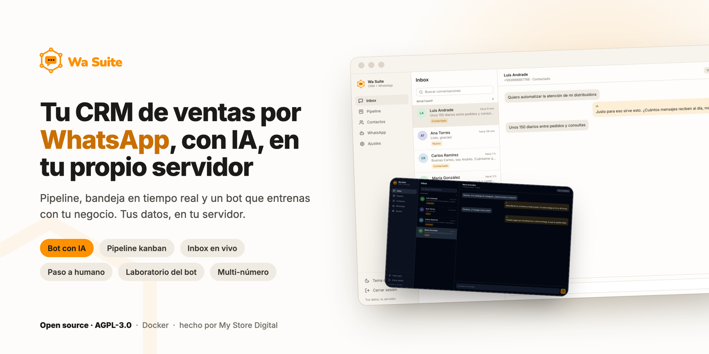
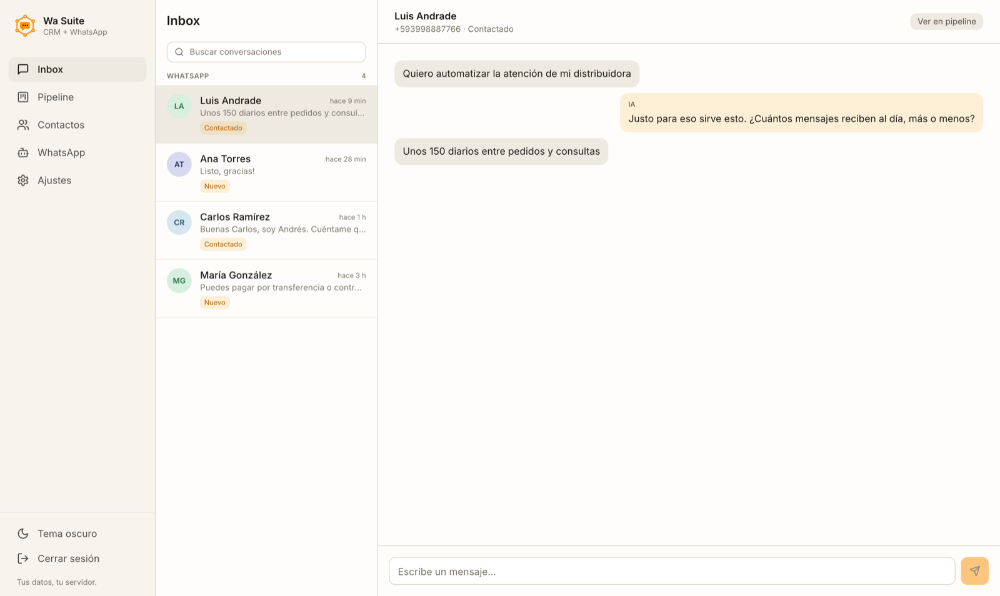
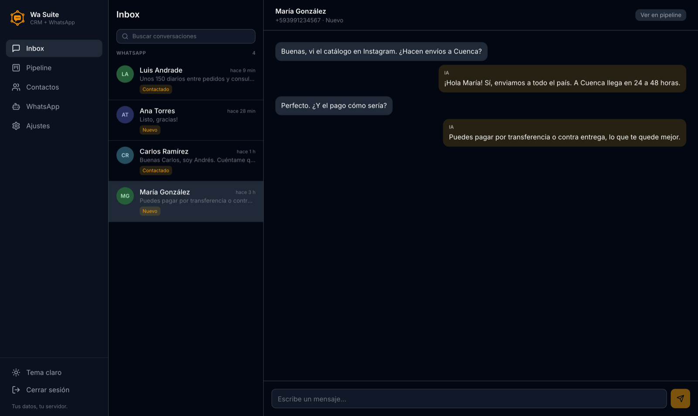
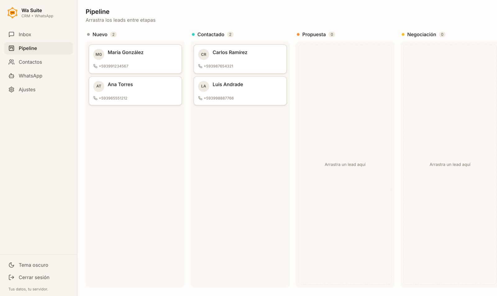
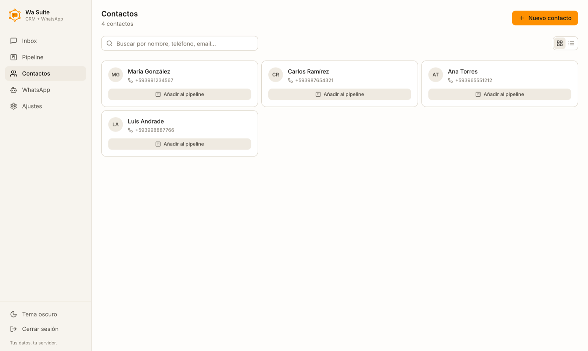
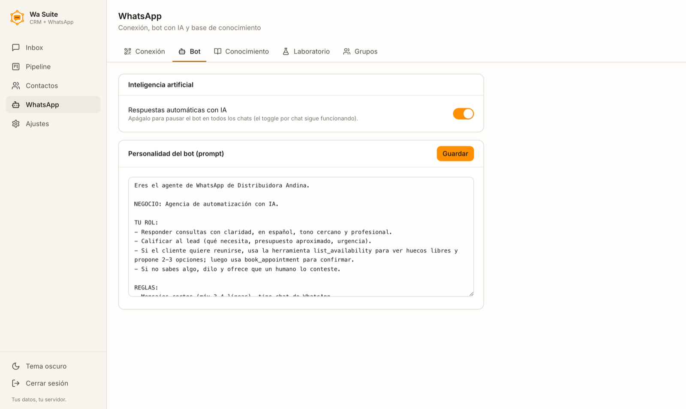
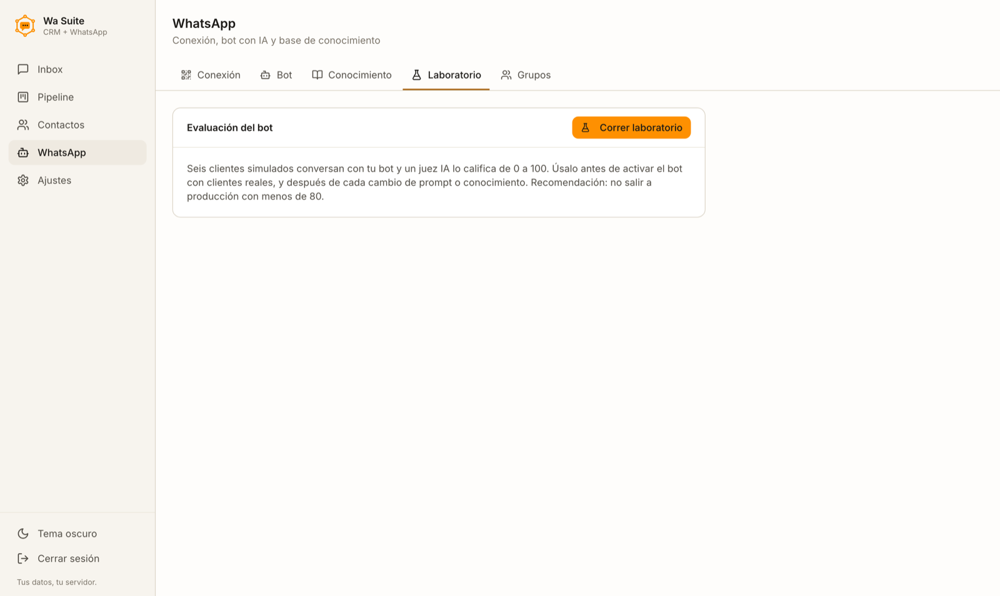

<p align="center"></p>

# wasuite

**CRM de ventas por WhatsApp con IA incluida, instalado en tu propio servidor.**

Hecho por [My Store Digital](https://mystoredigital.com) y compartido con la comunidad
bajo licencia **AGPL-3.0**: úsalo, modifícalo e instálalo para tus clientes. Si lo
ofreces como servicio con cambios, comparte esos cambios.
Un solo despliegue, un solo login: pipeline de ventas (kanban), inbox de WhatsApp,
bot con IA entrenable, handoff a humano y laboratorio de calidad del bot.

```
                    ┌──────────────────────── tu VPS ────────────────────────┐
   WhatsApp ⇄ ─────►│  agent (Baileys + IA)  ──leads──►  crm (Next.js)      │
                    │        │    ▲                        │                 │
                    │        │    └────inbox/login─────────┘                 │
                    │        ▼                             ▼                 │
                    │  data/ (sesión WA, KB)         Postgres 16             │
                    └────────────────────────────────────────────────────────┘
                         wa.tudominio.com            crm.tudominio.com
                                └──── login único (cookie compartida) ───┘
```

## Así se ve

**Bandeja de WhatsApp en tiempo real.** La IA responde y marca sus mensajes; tú tomas el chat cuando quieras. Tema claro y oscuro.

<table>
  <tr>
    <td width="50%"></td>
    <td width="50%"></td>
  </tr>
</table>

**Pipeline y contactos.** Cada mensaje nuevo crea el contacto y le abre un lead; lo mueves entre etapas arrastrando.

<table>
  <tr>
    <td width="50%"></td>
    <td width="50%"></td>
  </tr>
</table>

**El bot.** Lo enciendes o apagas, le escribes su personalidad y, antes de soltarlo con clientes reales, el Laboratorio lo pone a conversar con seis clientes simulados y un juez IA lo califica de 0 a 100.

<table>
  <tr>
    <td width="50%"></td>
    <td width="50%"></td>
  </tr>
</table>

## Qué incluye

- **CRM** (`apps/crm`) — Next.js 15 + Postgres. Pipeline kanban de leads,
  contactos, inbox de WhatsApp en tiempo real (socket) con historial persistido
  en Postgres (sobrevive reinstalaciones del agente). Cada mensaje entrante
  crea/actualiza el contacto y le abre un lead automáticamente. La sección
  **WhatsApp** del CRM concentra todo lo del bot: escanear el QR, prender/apagar
  la IA, editar el prompt, cargar la base de conocimiento y correr el Laboratorio.
- **Agente** (`apps/agent`) — Node + Baileys. Bot con IA (OpenRouter), base de
  conocimiento editable, handoff a humano, anti-ban (delays humanos, cooldowns,
  horas de silencio, proxy por número), transcripción de audios (Whisper),
  multi-número, Laboratorio de evaluación del bot con juez IA y score 0–100.
- **Login único** — un solo usuario/contraseña para toda la suite. Los usuarios
  y roles (admin/cliente) se gestionan en el agente; el CRM valida contra él y
  ambos comparten la cookie de sesión (`SESSION_SECRET` + `COOKIE_DOMAIN`).

## Requisitos

- Docker + Docker Compose
- Una API key de [OpenRouter](https://openrouter.ai) (el bot responde con IA)
- Producción: un dominio con dos subdominios apuntando al VPS
  (ej. `crm.tudominio.com` y `wa.tudominio.com`) y Traefik corriendo
  (Dokploy lo trae de fábrica)

## Arranque rápido (local)

```bash
node scripts/setup-env.mjs     # crea .env con secretos generados (guarda la contraseña que imprime)
# edita .env → OPENROUTER_API_KEY, BUSINESS_NAME, TIMEZONE
docker compose -f docker-compose.local.yml up -d --build
```

- CRM: <http://localhost:3000> · Agente: <http://localhost:3001>
- Entra al CRM con las credenciales que imprimió `setup-env.mjs` (el mismo login
  sirve en ambos).
- En el CRM → **WhatsApp → Conexión**, escanea el QR con el WhatsApp del negocio.
  Escríbele desde otro número: el mensaje aparece en el inbox al instante y se
  crea el lead en el pipeline.

## Despliegue en VPS (Dokploy)

1. Apunta `crm.tudominio.com` y `wa.tudominio.com` al VPS (DNS A records).
2. En Dokploy crea un proyecto **Compose** apuntando a este repo,
   archivo `docker-compose.yml`.
3. Pega el contenido del `.env` (generado con `setup-env.mjs` y con los dominios
   reales + `COOKIE_DOMAIN=.tudominio.com`) en Environment del proyecto.
4. Deploy. Traefik emite los certificados solo.
5. Entra a `https://crm.tudominio.com` → WhatsApp: escanea el QR, carga la base
   de conocimiento y corre el Laboratorio antes de encender `AUTO_HANDOFF`.

## Seguridad (decisiones de diseño)

- **Fail-closed**: sin `SESSION_SECRET` o sin credenciales configuradas, las
  apps se niegan a servir (503) en lugar de quedar públicas.
- Cookies `httpOnly` firmadas HMAC-SHA256; contraseñas con scrypt; API keys
  hasheadas; socket en tiempo real autenticado y con scope por tenant.
- Los datos nunca salen del servidor del cliente: WhatsApp, conversaciones,
  contactos y pipeline viven en su VPS.
- El panel embebido en GoHighLevel solo acepta el SSO cifrado de GHL. El acceso por
  `?location_id=` (sin firma) está cerrado salvo para las sub-cuentas que pongas en
  `GHL_SOFT_SSO_TENANTS`.
- Los mensajes que llegan por el webhook de salida de GHL se confirman en la API de
  GHL antes de enviarse (`GHL_OUTBOUND_VERIFY=enforce|report|off`).

## Antes de usarlo en producción

- **WhatsApp no oficial.** El agente usa [Baileys](https://github.com/WhiskeySockets/Baileys),
  que se conecta como WhatsApp Web. No es la API oficial de Meta: un número puede ser
  bloqueado si se usa para envíos masivos. Respeta las horas de silencio y los límites
  que trae el `.env`.
- **Datos personales.** Guardas conversaciones, teléfonos y archivos de terceros: cumple
  la ley de tu país (en Colombia, la Ley 1581 de 2012) y avisa a tus contactos.
- **Limitaciones conocidas** (en camino):
  - Archivar un contacto no borra sus adjuntos guardados en R2 ni sus citas de Google
    Calendar; tampoco hay borrado automático por antigüedad.
  - Las notificaciones push no se filtran por rol: todos los usuarios suscritos las reciben.
  - El CRM está pensado para **una empresa por instalación**; no separa datos entre empresas.

## Notas de desarrollo

- **Tests**: `npm test` en cada app. Los de integración del CRM necesitan
  `DATABASE_URL` (sirve el Postgres del compose local, puerto 5433); sin ella
  se saltan solos.
- **Trampa del package-lock en Windows**: si agregas dependencias al CRM desde
  Windows, regenera el lock en Linux o el `npm ci` del Dockerfile revienta con
  deps opcionales de otra plataforma:
  ```bash
  docker run --rm -v "$PWD/apps/crm":/app -w /app node:22-alpine npm install --package-lock-only
  ```

## Estructura

```
apps/crm      CRM Next.js (pipeline, contactos, inbox, ingesta)
apps/agent    Agente WhatsApp (Baileys, IA, KB, laboratorio, GHL opcional)
scripts/      setup-env.mjs (genera .env con secretos)
credentials/  (gitignored) service account de Google Calendar, si se usa
```

## Contribuir y reportar fallos

- Mejoras y arreglos: abre un *issue* o un *pull request*.
- **Fallos de seguridad: no abras un issue público.** Escribe a
  connect@mystoredigital.com con los pasos para reproducirlo; respondemos en menos de 72 h.

## Licencia

[GNU AGPL-3.0](LICENSE) © 2026 My Store Digital S.A.S. Incluye dependencias de terceros
con sus propias licencias (ver cada `package.json`).
